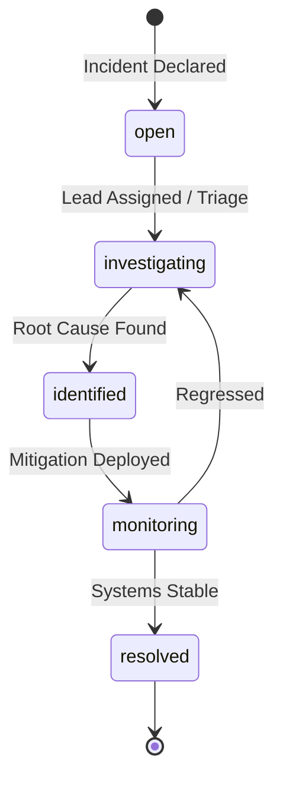

# Alerting, Incident Management & Insights Specification

**Document Version**: 1.0  
**Phase**: 9 (Visibility)  
**Status**: Approved & Authoritative  
**Audience**: NOC Engineers, Platform Operators, Backend Developers, SREs

---

## 1. Overview & Architecture

The Znero Alert Engine provides real-time anomaly detection, incident response workflows, and operational insights across telecom switching, routing, provider health, message pipelines, and financial ledger integrity.

```
       +-----------------------------------------------------------+
       |                  Metric & Telemetry Sources               |
       |  (Live NOC, Prometheus Registry, Outbox, Ledger, DLRs)   |
       +-----------------------------+-----------------------------+
                                     |
                                     v
                       +---------------------------+
                       |   Alert Rules Evaluator   |
                       | (Evaluates active rules)  |
                       +-------------+-------------+
                                     |
                                     v
                       +---------------------------+
                       |       Alert Manager       |
                       |  - Flapping Protection    |
                       |  - Silence Management     |
                       |  - State Persistence      |
                       +------+--------------+-----+
                              |              |
             (Auto-escalate)  v              v  (Dispatch)
               +-------------------+   +-------------------------+
               |  Incident Manager |   |   Notification Center   |
               | - State Machine   |   | (In-App, Email, Webhook)|
               | - Timeline Audit  |   +-------------------------+
               +-------------------+
```

---

## 2. Built-in Alert Rule Catalog

All alert rules are defined in the `alert_rules` table and evaluated continuously by the Alerting Engine.

| Rule Name | Condition Type | Threshold | Default Window | Severity | Scope | Description |
|:---|:---|:---|:---|:---|:---|:---|
| `high_failure_rate` | `delivery_failure_rate` | `> 10.0%` | 5 minutes | `critical` | `platform` | Delivery failure percentage exceeds 10% across minimum 100 sample messages. |
| `outbox_backlog_age` | `outbox_oldest_age_sec` | `> 60s` | 60 seconds | `critical` | `platform` | Unsent message has been pending in dispatcher outbox for over 60 seconds. |
| `reconciliation_discrepancy` | `ledger_discrepancy_count` | `> 0` | Immediate | `critical` | `platform` | Reconciliation between billing ledger and gateway message records detected discrepancy. |
| `carrier_connection_down` | `provider_conn_health` | `== 0` | 30 seconds | `critical` | `platform` | Upstream SMPP or HTTP provider connection disconnected or failing health probes. |
| `settlement_exception` | `settlement_error_count` | `> 0` | Immediate | `warning` | `platform` | DLR reaper or hold settlement encountered an unresolvable accounting state. |
| `low_margin_detected` | `margin_percentage` | `< 5.0%` | 15 minutes | `warning` | `platform` | Aggregate margin for destination traffic dropped below minimum margin threshold. |

---

## 3. Anti-Flapping & Hysteresis Design

To eliminate alert fatigue and notification storms during transient jitter, the alert engine enforces strict hysteresis:

1. **Duration Requirement (Pending -> Firing)**:
   - A metric must exceed the threshold continuously for `duration_seconds` before the alert enters `firing` state.
   - Transient spikes lasting less than `duration_seconds` are logged but do not trigger notifications.
2. **Auto-Resolution Hysteresis (Firing -> Resolved)**:
   - When a firing alert's condition clears, the condition must remain cleared for at least 1 evaluation cycle before transitioning to `resolved`.
   - On resolution, a `resolved` notification is dispatched to notify on-call operators that normalcy has been restored.
3. **Silence Management**:
   - Operators can silence an active alert for a chosen duration (e.g., 30m, 2h, 24h).
   - While silenced, the alert remains marked as firing in dashboards, but outgoing notifications (email, webhook, in-app push) are suppressed.

---

## 4. Incident Management Lifecycle State Machine

Critical alerts and major system degradations can be escalated into formal platform incidents with tracked accountability and timeline audits.

### Incident States



### Transition Validation Rules

| Current State | Permitted Next States | Description |
|:---|:---|:---|
| `open` | `investigating` | Triage underway; lead responder assigned. |
| `investigating` | `identified`, `monitoring` | Root cause identified or immediate mitigation applied. |
| `identified` | `monitoring`, `investigating` | Fix deployed; under observation. |
| `monitoring` | `resolved`, `investigating` | Confirmed resolved, or reverted back to investigation if instability returns. |
| `resolved` | `reopened` (transitions to `investigating`) | Post-incident closure; can be reopened if recurrence occurs within 24h. |

### Incident Timeline Entries

Every action during an incident is recorded in `incident_timeline` with immutable audit properties:
- `entry_type`: `state_change`, `note`, `mitigation`, `metric_snapshot`.
- `author_user_id`: Operator responsible for the timeline entry.
- `content`: Markdown-formatted description or diagnostic payload.
- `created_at`: Cryptographically verifiable UTC timestamp.

---

## 5. Tenancy & Data Privacy Guardrails

1. **Platform Exclusivity**:
   - `alert.*` and `incident.*` permissions are restricted to the platform organization.
   - Resellers and customers cannot view platform alert rules, upstream carrier connectivity states, buy costs, or internal incident post-mortems.
2. **Customer Visibility**:
   - Customer-scoped notifications (e.g., wallet low, rate changes) are filtered and dispatched through the Notification Center without referencing provider identities or upstream errors.

