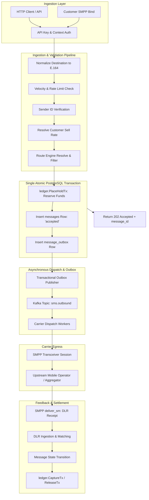
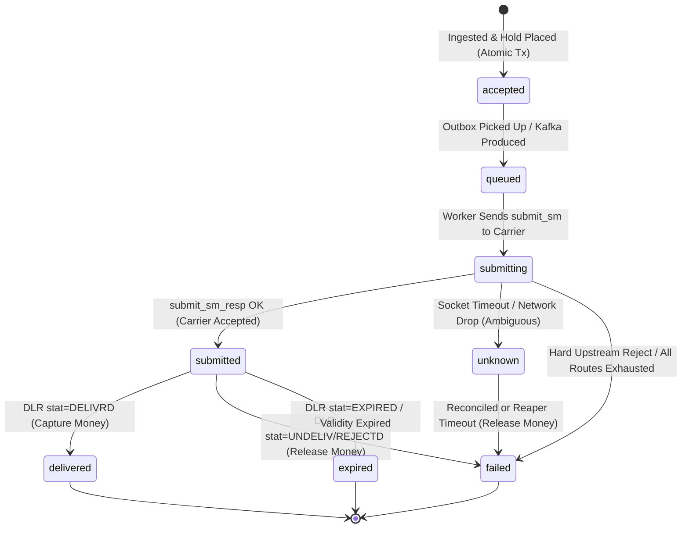
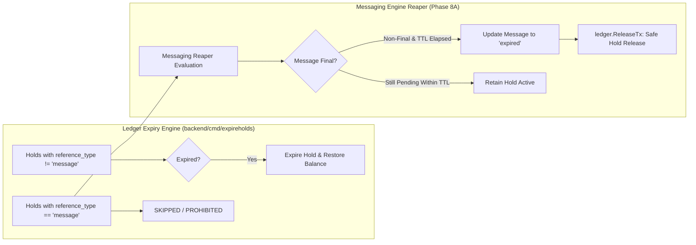
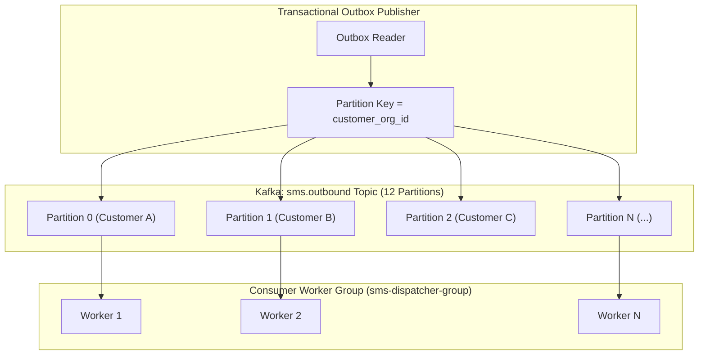

# Znero International — Messaging Engine Architecture & Design Specification (Phase 8A)

---

## 1. Executive Summary & Purpose

Phase 8 implements the high-throughput, carrier-grade SMS messaging pipeline for Znero International. Phase 8A focuses on the **submission pipeline, transactional outbox, asynchronous dispatching, state machine, failover controls, SMPP protocol interfacing, and financial double-entry settlement**.

This document defines the authoritative architecture, end-to-end processing pipeline, state machine transitions, error handling policies, settlement workflows, database models, and operational runbooks for the messaging engine.

---

## 2. Core Architectural Principles

1. **Atomic Ingestion & Funds Reservation**:
   Every message submission executes within a single PostgreSQL transaction that simultaneously inserts the canonical message record, writes the transactional outbox entry, and reserves customer funds via double-entry balance hold (`ledger.Service.PlaceHoldTx`). A failure in any component rolls back the entire submission, ensuring zero unreserved message dispatches and zero ghost holds.
2. **Deterministic & Explainable Routing**:
   Routing decisions are produced by the Phase 7 in-memory routing engine (`routing.Engine.Resolve`), evaluating hard eligibility filters, kill-switch status, provider coverage, dynamic rate sheets, and margin thresholds in ~12 µs without per-message database I/O.
3. **Ambiguous Outcomes (`unknown`) & The Never-Auto-Resend Rule**:
   Telecommunications network splits, downstream TCP socket drops, and upstream provider drops without a definitive `submit_sm_resp` produce an `unknown` state. **The engine strictly prohibits automatic failover or resending on ambiguous outcomes** to prevent catastrophic duplicate message delivery and duplicate customer billing.
4. **Separation of Reaper Duties**:
   Hold duration must exceed message validity TTL plus the unknown-resolution window. The general ledger `ExpireOldHolds` job is prohibited from releasing holds linked to non-final messages (`reference_type = 'message'`); the **Messaging Reaper** is the sole authority permitted to resolve non-final message holds.
5. **Decoupled Asynchronous Dispatch**:
   Client ingestion (`HTTP POST /api/v1/messages` and SMPP server `submit_sm`) is decoupled from upstream carrier dispatch via a transactional outbox and Apache Kafka partitions, ensuring sustained client throughput regardless of carrier latency or transient provider throttles.

---

## 3. High-Level Architecture Diagram



---

## 4. End-to-End Submission Pipeline (Phase 8A)

Every outbound message traverses the following sequential stages:

```
[1. Auth & Context] 
       │
[2. Velocity & Rate Limits] 
       │
[3. Number Normalization & E.164 Intelligence] 
       │
[4. Sender ID Policy & Commercial Profile Gating] 
       │
[5. Rating Engine: Sell Rate Resolution] 
       │
[6. Routing Engine: Plan, Strategy & Egress Resolution] 
       │
[7. Atomic DB Tx: PlaceHoldTx + Message Insert + Outbox] 
       │
[8. Synchronous 202 Accepted Response to Client]
```

### Detailed Pipeline Stages

1. **Authentication & Tenant Scoping**:
   - HTTP requests authenticate via `Authorization: Bearer <api_key>` (checked via `customer.Service.AuthenticateAPIKey`).
   - Customer SMPP accounts authenticate via `system_id` and Argon2id password hash (`customer.Service.AuthenticateSMPPAccount`).
   - Tenant context (`tenant.Context`) is resolved, enforcing leaf organization boundary and active commercial profile status.
2. **Velocity & Throttling Enforcement**:
   - In-memory token bucket verifies per-customer submission rate limits (e.g. 50 msg/sec default) and system-wide IP velocity rules.
   - Breaches immediately return `429 Too Many Requests` without touching PostgreSQL.
3. **Destination Number Normalization & Intelligence**:
   - `number.NormalizeToE164(dest, defaultCallingCode)` validates E.164 compliance (7–15 digits, international dialing format).
   - In-memory prefix trie resolves country ISO2, operator ID, and national destination code. Non-E.164 numbers are unconditionally rejected with `400 Bad Request` (`invalid_number`).
4. **Sender ID Verification & Commercial Policy**:
   - Validates that the requested `sender_id` is registered and approved for this customer organization (`senderid.Service.ValidateSenderIDForCustomer`).
   - Matches sender ID type (`alphanumeric`, `numeric`, `shortcode`) against destination country regulatory policy and customer profile allowed countries.
5. **Rating Engine (Customer Sell Rate)**:
   - Evaluates customer sell rate sheet via Phase 5 Rating Engine (`rating.Engine.ResolveCustomerSellRate`).
   - Verifies effective date window (`effective_from <= now < effective_to`).
   - Determines exact decimal message unit price (`shopspring/decimal`, `NUMERIC(18,6)`). If no sell rate exists, message is rejected with `422 Unprocessable Entity` (`missing_sell_rate`).
6. **Routing Engine Decision (Primary & Fallback Candidate Selection)**:
   - Invokes `routing.Engine.Resolve` using the immutable in-memory snapshot.
   - Evaluates hard filters: provider active status, egress connection active status, emergency kill-switch override, provider country/operator coverage (tested coverage gating), and sender ID type compliance.
   - Compares customer sell rate against provider buy rate to verify minimum margin (`margin_percent >= min_margin`).
   - Sorts eligible candidates according to route plan strategy (`priority`, `least_cost` with exact decimal tie-breaking, or `weighted` split).
   - Returns ordered fallback list of connections (`Candidates[0]` = primary, `Candidates[1..N]` = fallback routes).
7. **Atomic PostgreSQL Transaction (`PlaceHoldTx` + Message + Outbox)**:
   - A single PostgreSQL transaction (`tx, _ := pool.Begin(ctx)`) executes:
     1. `ledger.Service.PlaceHoldTx`: Pre-funds the message by placing an active balance hold for `customer_sell_rate` on the customer's wallet. (Prepaid wallets check `AvailableBalance >= amount`; postpaid wallets enforce `CachedBalance + CreditLimit - ActiveHolds >= amount`).
     2. `messages` row insert: Stores message metadata, normalized destination, assigned routes, sell price, estimated buy cost, and initial status `accepted`.
     3. `message_outbox` row insert: Enqueues message payload for asynchronous dispatcher.
   - On commit, the transaction guarantees strict atomicity.
8. **Client Response**:
   - HTTP API responds with `202 Accepted`:
     ```json
     {
       "message_id": "7f8b9c2a-3d4e-4f5a-8b6c-1d2e3f4a5b6c",
       "status": "accepted",
       "destination": "+12025550199",
       "parts": 1,
       "currency": "USD",
       "price": "0.0050",
       "created_at": "2026-11-08T02:00:00Z"
     }
     ```

---

## 5. Message Lifecycle & State Machine



### State Machine Transition Rules & Invariants

| From State | To State | Trigger Event | Financial Action | Allowed Next Actions |
| :--- | :--- | :--- | :--- | :--- |
| `[*]` | `accepted` | Ingestion pipeline commits atomic transaction | Hold placed on customer wallet (`PlaceHoldTx`) | Enqueue to dispatcher |
| `accepted` | `queued` | Outbox publisher pushes to dispatch topic | None | Worker pickup |
| `queued` | `submitting` | Carrier worker claims message and initiates TCP submit | None | Upstream dispatch |
| `submitting` | `submitted` | Upstream carrier returns `submit_sm_resp` with `command_status == 0` | If trigger is `on_provider_accept`, capture hold (`CaptureTx`); otherwise hold remains | Await DLR receipt |
| `submitting` | `submitting` (failover) | Primary carrier returns retryable reject (`ESME_RSYSERR`, `ESME_RTHROTTLED`) | None | Call `routing.Next`, attempt fallback route |
| `submitting` | `failed` | All eligible fallback routes rejected, or non-retryable fatal error | Release hold on customer wallet (`ReleaseTx`) | Terminal state |
| `submitting` | `unknown` | Socket read timeout, TCP reset, or provider disconnect before response | **HOLD RETAINED**. NEVER auto-resend | Await reconciliation or reaper |
| `submitted` | `delivered` | Carrier DLR received with `stat:DELIVRD` | Capture hold on customer wallet (`CaptureTx`) | Terminal state |
| `submitted` | `failed` | Carrier DLR received with `stat:UNDELIV`, `stat:REJECTD` | Release hold on customer wallet (`ReleaseTx`) | Terminal state |
| `submitted` | `expired` | Carrier DLR received with `stat:EXPIRED` or validity period elapsed | Release hold on customer wallet (`ReleaseTx`) | Terminal state |
| `unknown` | `delivered` | Out-of-band query / late DLR confirms delivery | Capture hold on customer wallet (`CaptureTx`) | Terminal state |
| `unknown` | `failed` | Out-of-band query or Messaging Reaper confirms non-delivery | Release hold on customer wallet (`ReleaseTx`) | Terminal state |

---

## 6. The "Never Auto-Resend" Rule & Ambiguous Outcomes

### The Ambiguity Problem
When an SMPP client transmits a `submit_sm` PDU over TCP, the transport layer sends packets downstream to the carrier SMSC. If the TCP connection terminates, resets, or times out before receiving the `submit_sm_resp` packet:
- The SMSC **may have accepted** the message and submitted it to the mobile operator network.
- The SMSC **may have failed** before queuing the message.
- The client cannot know which outcome occurred from the socket state alone.

### Invariant & Safety Controls
1. **Never Auto-Resend**:
   Under no circumstances may the messaging dispatcher automatically failover to a secondary carrier or retransmit the PDU on the same connection when encountering a socket timeout or disconnect during `submitting`. Retransmission risks **duplicate SMS delivery to the handset and duplicate carrier charges**.
2. **Immediate Transition to `unknown`**:
   The message state transitions immediately to `unknown` with `failure_reason = "carrier socket timeout during submit_sm; delivery unconfirmed"`.
3. **Hold Retention**:
   The customer's balance hold remains reserved and active throughout the unknown-resolution window. Funds are neither captured nor released until authoritative confirmation is obtained.
4. **Resolution Paths**:
   - **Late DLR**: The carrier subsequently delivers the message and emits a `deliver_sm` DLR matching the destination and timestamp, transitioning the message to `delivered` and triggering `CaptureTx`.
   - **Messaging Reaper**: After the unknown-resolution window expires (e.g. 60 minutes) without a DLR, the Messaging Reaper marks the message `failed` and safely releases the hold via `ReleaseTx`.

---

## 7. Failover Policies (Route Switching)

Failover is executed exclusively via Phase 7's deterministic engine:
`routing.Engine.Next(ctx, req, failedConnectionIDs []uuid.UUID) (*Candidate, error)`

### Strict Failover Principle & Preconditions
> [!IMPORTANT]
> **Failover happens ONLY after a DEFINITIVE provider response classified as retryable on another route** (for example throttled, queue full, system error).
> - **Permanent failures** (invalid destination, invalid source, unallocated number, barred account) do NOT fail over. They terminate immediately as `failed`.
> - **Ambiguous outcomes** (socket timeout, dropped connection, network partition, crash after sending, no response) are classified as `unknown` and are **NEVER resent or failed over**.
> - Prior wording referencing "pre-submission rejections" is explicitly superseded: failover occurs post-submission only when the provider returns a definitive, retryable negative acknowledgment.

### Failover Eligibility Rules

| Scenario | Failover Permitted? | Engine Behavior |
| :--- | :---: | :--- |
| Upstream connection offline or bind down | **YES** | Add primary connection ID to `failedConnectionIDs`, call `Next()`, dispatch to fallback candidate. |
| Carrier returns definitive retryable error (`ESME_RTHROTTLED`, `ESME_RMSGQFUL`, `ESME_RSYSERR`) | **YES** | Record upstream error code, add connection to `failedConnectionIDs`, call `Next()`, retry on fallback up to max attempts. |
| Carrier returns definitive permanent error (`ESME_RINVPASWD`, `ESME_RINVDSTADR`, `ESME_RINVSYSID`) | **NO** | Mark message `failed`, release hold. Retrying on another carrier for bad destination number is disallowed. |
| Ambiguous network timeout / socket drop (`unknown`) | **STRICTLY PROHIBITED** | Retaining hold, status set to `unknown`. Zero failover attempts; never auto-resend. |
| Carrier returns `submit_sm_resp OK`, followed later by DLR `UNDELIV` | **NO** | Handset-level failure cannot be automatically rerouted after successful submission. Message is marked `failed`. |

---

## 8. Financial Settlement Matrix & Billing Triggers

Financial settlement is strictly coupled to double-entry bookkeeping in `backend/internal/ledger`.

### Customer Billing Trigger Decision Matrix

| Model | Description | Pre-Funding | On Provider Accept (`submit_sm_resp OK`) | On Terminal Delivery (`DELIVRD` DLR) | On Terminal Failure (`UNDELIV` / `REJECTD`) |
| :--- | :--- | :--- | :--- | :--- | :--- |
| **`on_delivery`** *(Default)* | Customer pays only for confirmed handset delivery. | Hold placed for sell rate (`PlaceHoldTx`) | Hold remains active; buy cost ledger transaction logged | Hold captured (`CaptureTx`) -> `CUSTOMER_FUNDS` debited, `PLATFORM_REVENUE` credited | Hold released (`ReleaseTx`) -> available balance restored |
| **`on_provider_accept`** | Customer pays once carrier accepts responsibility for submission. | Hold placed for sell rate (`PlaceHoldTx`) | Hold captured (`CaptureTx`) -> customer billed immediately | No financial change; customer already billed | If customer contract permits refund on DLR fail, discretionary credit issued |

### Upstream Carrier Cost Settlement (Buy Cost)
- Upstream carrier buy cost is settled based on provider contracts (typically charged upon carrier acceptance, regardless of handset delivery).
- Upon `submit_sm_resp OK`, the dispatcher logs an estimated buy cost liability in the internal operational ledger:
  - Debit: `COST_OF_GOODS_SOLD`
  - Credit: `ACCOUNTS_PAYABLE_CARRIER_<PROVIDER_ID>`

---

## 9. Hold Expiry vs Message Validity & Reaper Governance

### The Expiry Inequality Invariant & Configurable Settings
To prevent premature hold release while a message is in flight or awaiting carrier DLR, the system enforces the following mathematical hierarchy:

$$\text{hold\_expiry} > \text{message\_ttl} + \text{unknown\_resolution\_window}$$

All three parameters are configurable platform settings stored in `system_settings`:
- **`messaging.message_ttl`** (default: `24h` / `86400s`): Maximum lifetime of an uncompleted message before expiration.
- **`messaging.unknown_resolution_window`** (default: `24h` / `86400s`): Duration an ambiguous message remains in `unknown` awaiting late carrier resolution before reaper intervention.
- **`messaging.hold_expiry`** (default: `72h` / `259200s`): Lifetime of a customer balance reservation before ledger expiry.

### Startup Validation (Refuse Invalid Settings)
At engine initialization and service boot time, configuration validation strictly tests the inequality:
```go
if holdExpiry <= messageTTL + unknownResolutionWindow {
    return fmt.Errorf("invalid hold configuration: hold_expiry (%v) must exceed message_ttl (%v) + unknown_resolution_window (%v)", holdExpiry, messageTTL, unknownResolutionWindow)
}
```
If an administrator or configuration misconfigures these values (e.g. `hold_expiry = 24h` while `ttl = 24h`), the application **refuses to start**, preventing any risk of unbacked message dispatches or prematurely released customer holds.

### Separation of Duties Between Reapers



1. **`backend/cmd/expireholds` (Ledger Reaper)**:
   - Queries `holds WHERE status = 'active' AND expires_at < now() AND (reference_type IS NULL OR reference_type != 'message')`.
   - **Strictly excluded** from modifying holds linked to active messages.
2. **Messaging Reaper (`backend/cmd/messagereaper`)**:
   - Queries `messages WHERE status IN ('accepted', 'queued', 'submitting', 'submitted', 'unknown') AND created_at < now() - INTERVAL '6 hours'`.
   - Evaluates whether carrier reported any terminal status.
   - Marks message `expired` or `failed`.
   - Explicitly calls `ledger.Service.ReleaseTx(ctx, tx, message.HoldID)` in the same transaction that finalizes message status.

---

## 10. DLR Matching & Multipart Concatenation

### DLR PDU Format & Parsing
When an SMSC delivers an SMS status report, it issues an SMPP `deliver_sm` PDU. The DLR receipt is parsed from `short_message` or optional TLV parameters:
```text
id:0123456789 sub:001 dlvrd:001 submit date:2611080200 done date:2611080205 stat:DELIVRD err:000 text:Hello
```
1. **Extraction**:
   - `provider_message_id`: Extracted from `id:` field (e.g. `0123456789`).
   - `delivery_status`: Extracted from `stat:` field (`DELIVRD`, `UNDELIV`, `EXPIRED`, `DELETED`, `UNKNOWN`, `REJECTD`).
   - `error_code`: Extracted from `err:` field (e.g. `000` = success, `001` = handset absent, `004` = call barred).
2. **Matching Strategy**:
   - Database lookup on indexed table:
     `SELECT id, hold_id, customer_org_id, status FROM messages WHERE provider_connection_id = $1 AND provider_message_id = $2 FOR UPDATE`
   - If found, executes state machine transition and calls `ledger.CaptureTx` or `ledger.ReleaseTx`.
3. **Multipart Concatenation (CSMS)**:
   - Long messages (>160 GSM-7 or >70 UCS-2 characters) are fragmented into parts using GSM 03.40 UDH (User Data Header).
   - Each part carries: Reference Number (8-bit or 16-bit), Total Parts ($N$), and Sequence Number ($k$).
   - Ingestion calculates total billable parts ($N$) and places a hold for $N \times \text{unit\_price}$.
   - DLRs arrive per segment. The parent message transitions to `delivered` when segment 1 (or all segments) report delivery, and `CaptureTx` captures the full multi-part reservation.

---

## 11. Kafka Topic & Partitioning Strategy

To guarantee message ordering per customer while maintaining horizontal scalability across multi-core workers, dispatch topics are partitioned by customer organization:



- **Topic Name**: `sms.outbound`
- **Partition Count**: 12 partitions (scalable to 32).
- **Partitioning Key**: `customer_org_id.String()`:
  - Guarantees strict FIFO dispatching for any single customer organization.
  - Prevents Head-of-Line blocking: a high-volume batch from Customer A cannot starve or delay interactive OTP messages from Customer B on another partition.

### 11.1 PostgreSQL Database Partitioning & Uniqueness Strategy

PostgreSQL requires any unique index on a partitioned table to include all columns of the partition key. Because `messages` and `message_parts` are partitioned by `RANGE (created_at)`, a direct unique index on `(customer_org_id, client_reference)` would only enforce uniqueness within a single monthly partition, failing to prevent duplicates across month boundaries. The same limitation applies to provider message deduplication `(connection_id, provider_message_id)`.

#### Unpartitioned Lookup Tables
To guarantee global uniqueness and instantaneous lookups without cross-partition index scans, the engine introduces two dedicated **unpartitioned** lookup tables written within the same database transaction as the message:

1. **`message_idempotency_lookups`**:
   - `customer_org_id` (UUID) NOT NULL
   - `client_reference` (VARCHAR(128)) NOT NULL
   - `message_id` (UUID) NOT NULL
   - `message_created_at` (TIMESTAMPTZ) NOT NULL
   - `created_at` (TIMESTAMPTZ) NOT NULL DEFAULT now()
   - **Primary / Unique Key**: `(customer_org_id, client_reference)`
   - **Foreign Key**: `FOREIGN KEY (message_id, message_created_at) REFERENCES messages (id, created_at) ON DELETE CASCADE`
2. **`message_provider_lookups`**:
   - `connection_id` (UUID) NOT NULL
   - `provider_message_id` (VARCHAR(128)) NOT NULL
   - `message_id` (UUID) NOT NULL
   - `message_created_at` (TIMESTAMPTZ) NOT NULL
   - `created_at` (TIMESTAMPTZ) NOT NULL DEFAULT now()
   - **Primary / Unique Key**: `(connection_id, provider_message_id)`
   - **Foreign Key**: `FOREIGN KEY (message_id, message_created_at) REFERENCES messages (id, created_at) ON DELETE CASCADE`

**Guarantees**:
- Concurrent duplicate client submissions—even crossing a month boundary—are immediately rejected with `409 Conflict` (`ErrDuplicateClientReference`) via the unpartitioned primary key index.
- Inbound DLR lookups from carriers locate the message in $O(1)$ time by querying `message_provider_lookups` by `(connection_id, provider_message_id)` and retrieving `(message_id, message_created_at)`, directly targeting the exact partition of `messages`.

### 11.2 Partition Maintenance, Default Partition & Retention Plan

1. **Proactive Partition Pre-Creation**:
   - A partition management service runs daily to ensure that monthly partitions for the next $N$ months ($N \ge 3$, configurable via `messaging.partition_precreate_months`) are created ahead of time (e.g. `messages_2026_11`, `messages_2026_12`, `messages_2027_01`).
2. **Safety Net: Default Partitions**:
   - The tables include `messages_default` and `message_parts_default` attached as `DEFAULT` partitions.
   - Any message whose `created_at` falls outside pre-created date boundaries is safely routed to the default partition, guaranteeing that inserts **never fail** on the first day of a new month or under clock skew.
3. **Retention & Concurrent Detach**:
   - Messages older than the data retention threshold (e.g. 12 months) are detached using non-blocking DDL:
     ```sql
     ALTER TABLE messages DETACH PARTITION messages_2025_11 CONCURRENTLY;
     ALTER TABLE message_parts DETACH PARTITION message_parts_2025_11 CONCURRENTLY;
     ```
   - Detached tables are exported to cold analytical storage (e.g. Parquet / S3) and dropped without holding locks on active partitions.

---

## 12. SMPP Client Library Decision

### Selected Implementation: Custom Clean-Room SMPP 3.4 PDU Codec & Session Engine (`internal/smpp`)
While `gosmpp` was considered during initial design research, full protocol implementation analysis revealed critical architectural gaps regarding dial-time SSRF protection, strict TLS SNI verification, sliding window semaphore alignment with Postgres connection limits, context-aware PDU cancellation, and dual-use parity with the Mock SMSC simulator. 

Consequently, Znero implemented a native, clean-room SMPP 3.4 PDU codec and connection manager in `internal/smpp`:
1. **Dial-Time SSRF Protection**: Custom `SafeDialer` resolves DNS and verifies **every** resolved IP against blocked RFC 1918, RFC 3927 (cloud metadata), and carrier-grade NAT CIDRs before establishing the TCP connection.
2. **Strict TLS 1.2+ Verification**: Explicit SNI preservation with `tls.Config{MinVersion: tls.VersionTLS12, ServerName: host}`. `InsecureSkipVerify` is strictly prohibited.
3. **Sliding Window & Context Timeout**: Sliding window semaphore buffer bounded by `provider_connections.smpp_window_size`. Submissions cleanly time out into `SendStatusUnknown` without leaking goroutines or connections.
4. **Zero External Supply Chain Risk**: Pure Go standard library (`encoding/binary`, `crypto/tls`, `net`, `sync`), eliminating third-party CVE risks.
5. **Full Specification & Mapping**: See `docs/SMPP_NOTES.md` for complete error classification tables, outcome rules, and aggregation logic.

---

## 13. Open Business Decisions

The following business rule is formally documented as open:

### Open Decision: Customer Billing Trigger (`on_delivery` vs `on_provider_accept`)
1. **Current System Default**: `on_delivery`.
   - Customer wallet balance is debited (`CaptureTx`) only upon receiving a definitive `DELIVRD` DLR receipt from the operator.
   - If an SMS fails upstream (`UNDELIV`), the customer is refunded via hold release (`ReleaseTx`).
2. **Alternative Model**: `on_provider_accept`.
   - Common in wholesale Tier-1 transit where the customer purchases network attempts rather than handset delivery guarantees.
   - Customer wallet balance is captured immediately upon `submit_sm_resp OK`.
3. **Architecture Implementation**:
   - Stored in `system_settings` table under key `billing.sms.customer_trigger` (allowed values: `'on_delivery'`, `'on_provider_accept'`).
   - Governed by **Platform Super Admin with Maker-Checker dual control**.
   - Can be overridden at the customer profile level via `customer_profiles.billing_trigger_override` (`'default'`, `'on_delivery'`, `'on_provider_accept'`) if explicitly permitted by wholesale contract.

---

## 14. Phase 8A Delivery Chunk Plan

Phase 8A is partitioned into three gated milestones:

| Chunk | Scope & Steps | Status |
| :--- | :--- | :--- |
| **Chunk 1** | **Part A**: Ledger Tx methods (`PlaceHoldTx`, `CaptureTx`, `ReleaseTx`, `PostChargeTx`, idempotency replays).<br>**Part B (Step 1)**: Authoritative Design Document (`docs/MESSAGING_DESIGN.md`).<br>**Step 2**: Data model & Migration 10 (`messages`, `message_outbox`, `message_events`, lookup tables).<br>**Step 3**: Ingestion pipeline (`POST /api/v1/messages`) with atomic `PlaceHoldTx` & outbox write.<br>**Step 4**: Transactional outbox reader & dispatcher with routing and failover. | **Completed & Verified** |
| **Chunk 2** | **Step 6**: Mock carrier SMSC simulator (port 2775, configurable DLR latency, DLR modes, reject codes).<br>**Step 5**: Clean-room SMPP client with SSRF-safe dialer, TLS 1.2+ SNI verification, sliding windowing, and session persistence. | **Completed & Verified** |
| **Chunk 3** | **Steps 7–11**: Migration 11, DLR ingestion & dual-representation matching, financial settlement in atomic Tx (`CaptureTx`/`ReleaseTx`), Messaging Reaper (advisory locked), Reconciliation runner, REST APIs, Frontend operational screens, and DEV sample seed script. | **Completed & Verified** |

---

> **Phase 8A Implementation Status**:
> Chunks 1, 2, and 3 are fully implemented with zero build, vet, or TypeScript errors. Awaiting user go-ahead for test execution, verification runs, and handover packaging in Phase 8A closeout.


---

## 15. Message Lifecycle — Manager State Mapping

The platform manager's lifecycle uses the following stages. This table maps each manager state to either a code `status` column value or a `message_events.event_type` entry recorded in the same transaction.

| Manager State | Code Representation | Recorded When |
|:---|:---|:---|
| **RECEIVED** | `event_type = "submitted"`, `to_status = "accepted"` | Customer submits via HTTP POST or SMPP `submit_sm`. Initial insert. |
| **VALIDATED** | Implicit in the submission pipeline | Destination normalises to E.164, sender ID verified, encoding detected, message length within limits — all in-process before the DB transaction. No separate event; failure = `rejected` stored immediately. |
| **AUTHORIZED** | `event_type = "submitted"`, `to_status = "accepted"` | `PlaceHoldTx` succeeds in the same atomic transaction as the message insert. Hold ID stored on the message row. |
| **QUEUED** | `status = "accepted"`, outbox row `status = "pending"` | Outbox writer dispatches the outbox row to Kafka. Status remains `accepted` until dispatcher picks it up. |
| **ROUTED** | `status = "queued"` | Dispatcher reads outbox, calls `routing.Engine.Resolve`, selects provider connection. Status updated to `queued`. |
| **SUBMITTED** | `status = "submitting"` → `status = "submitted"` | `submitting` set when SMPP `submit_sm` / HTTP is sent to provider. `submitted` set when provider returns a definitive OK response with a message ID. |
| **PROVIDER_ACCEPTED** | `status = "submitted"` + `provider_message_id` stored | `provider_message_id` written alongside the `submitted` status. No separate status value — the stored ID is the evidence of provider acceptance. |
| **DELIVERED** | `status = "delivered"` | `deliver_sm` receipt / HTTP DLR callback arrives with `DELIVRD` or equivalent; `CaptureTx` or `PostChargeTx` fires in the same transaction (billing trigger dependent). |
| **FAILED** | `status = "failed"` or `status = "undelivered"` | Permanent provider reject (`UNDELIV`, `REJECTD`, etc.) or reaper TTL expiry. Hold released (`ReleaseTx`) or captured (`CaptureTx`) depending on billing trigger. |
| **EXPIRED** | `status = "expired"` | Reaper marks messages in `submitted` state past TTL with no DLR as expired. Hold treatment per NoDLR policy (see §16). |
| **UNKNOWN** | `status = "unknown"` | Ambiguous outcome (timeout, dropped connection, crash after PDU write). **Never auto-resent**. Hold retained until unknown-resolution window elapses, then released with exposure flag. |

> [!NOTE]
> The intermediate `submitting` status (while the PDU is in-flight) is an internal platform state not exposed in customer-facing APIs. Customers see only: `accepted`, `queued`, `submitted`, `delivered`, `failed`, `expired`, `unknown`.

> [!IMPORTANT]
> State transitions are **strictly monotonic**. Final states (`delivered`, `failed`, `expired`, `unknown`, `rejected`) are never overwritten. A conflicting later DLR is recorded in `message_events` with `event_type = "dlr_conflict"` and flagged for review.

---

## 16. NoDLR Hold Policy

When a message reaches `submitted` state but no DLR arrives before the message TTL, the Reaper transitions it to `expired`. The `NoDLRHoldPolicy` governs what happens to the customer wallet hold at that point (only relevant when `billing_trigger = "on_delivery"`).

| Policy Value | Behaviour | Use Case |
|:---|:---|:---|
| `retain_until_resolution` | Hold is retained past TTL and released only after `unknown_resolution_window` elapses. A `SettlementException` of type `no_dlr_expired_exposure` is recorded. | **Default (safe)**. Gives provider time to deliver a late DLR. Supplier liability exposure is flagged for finance review. |
| `immediate_release` | Hold is released immediately when the message TTL expires, without waiting for the resolution window. | Aggressive cash-flow preference; accept potential write-off risk on late DLRs. |
| `capture_at_ttl` | Hold is **captured** (customer charged) in the same transaction as the `expired` state change. A `SettlementException` of type `capture_at_ttl` is recorded for finance review. | Use when the platform bears the supplier cost and must recover it even without delivery confirmation. |

Configure via `MESSAGING_NO_DLR_HOLD_POLICY` environment variable (default: `retain_until_resolution`).

---

## 17. Per-Customer Billing Terms & Message Snapshot Rule

Per business requirements (Migration `000013`), SMS billing terms are configured **per customer** on `customer_profiles` rather than fixed globally across the entire platform:

| Field | Allowed Values / Range | Default (from Global) | Purpose |
| :--- | :--- | :--- | :--- |
| `billing_mode` | `on_provider_accept` \| `on_delivery` | `billing.sms.customer_trigger` (`on_delivery`) | Determines when the customer's wallet hold is captured. |
| `dlr_wait_hours` | `1..168` integer hours | `24` | Wait window for `on_delivery` messages before reaper no-DLR policy triggers. Separate from upstream SMPP `validity_period`. |
| `no_dlr_policy` | `retain_until_resolution` \| `immediate_release` \| `capture_at_ttl` | `NO_DLR_HOLD_POLICY` (`retain_until_resolution`) | Controls hold handling when `dlr_wait_hours` elapses without a DLR (`on_delivery` only). |
| `failed_after_accept_policy` | `keep_charge` \| `refund` | `keep_charge` | Applies only to `on_provider_accept` when an already-accepted/captured message later receives a `FAILED` / `UNDELIV` / `REJECTD` / `EXPIRED` DLR. |

### Access Control & Governance
- **Platform-Only**: Only platform users with permission may view, create, edit, or roll back billing terms; reseller and customer roles receive `403 Forbidden` if attempting to specify or modify billing terms. Customers can read their own terms read-only via `GET /customer/account` and the portal profile.
- **Maker-Checker, Versioning & Audit**: Modifying billing terms routes through Maker-Checker approval (`sensitiveChange = true`), increments `customer_profiles.version`, snapshots into `customer_profiles_history`, and records audited before/after JSON deltas.

### Immutable Message Snapshot Rule
When a message is authorized in `messaging.Service.Submit`, the customer's active billing terms are snapshotted onto the `messages` row (`billing_mode_snapshot`, `dlr_wait_hours_snapshot`, `no_dlr_policy_snapshot`, `failed_after_accept_policy_snapshot`), and hold expiry is extended past `dlr_wait_hours_snapshot + UnknownResolutionWindow`. All downstream settlement (`Dispatcher.handleAccepted`, `DLRProcessor`, `Reaper`, `ReconciliationService`) reads **only** from these immutable message snapshot columns — never from live `customer_profiles` — ensuring mid-flight billing changes never corrupt active messages.

- **`on_provider_accept`**:
  - Dispatcher calls `ledgerSvc.CaptureTx` inside the **same database transaction** that marks the message `submitted` (`PROVIDER_ACCEPTED`) with idempotency key `capture-<msg_id>`.
  - Permanent provider reject releases the hold immediately.
  - Later `FAILED` / `UNDELIV` / `EXPIRED` DLR checks `failed_after_accept_policy_snapshot`: `keep_charge` retains the captured revenue (standard wholesale transit), while `refund` invokes `ledgerSvc.RefundCaptureTx` (posting a balanced `refund` entry debiting `PLATFORM_REVENUE` and crediting the customer wallet, marking the hold `'refunded'`).
- **`on_delivery`**:
  - Capture occurs atomically on `DELIVRD`; release occurs atomically on `FAILED` / `UNDELIV` / `REJECTD`.
  - When `submitted_at + dlr_wait_hours_snapshot` elapses with no receipt:
    - `retain_until_resolution` transitions the message `submitted -> unknown`, retains the hold for late DLRs, and records a `no_dlr_retained_exposure` settlement exception until `UnknownResolutionWindow` elapses.
    - `immediate_release` transitions to `expired` and releases the hold immediately.
    - `capture_at_ttl` transitions to `expired`, captures the hold, and logs a `capture_at_ttl` settlement exception.

---

## 18. Unified Egress & Generic HTTP Provider Connector

All outbound SMS traffic (whether accepted via Customer HTTP API or Customer SMPP Server) is unified behind `messaging.Sender`, wired through `messaging.CompositeSender` (`internal/messaging/composite_sender.go`), which resolves the route connection's `protocol` (`smpp` or `http`) and delegates seamlessly.

### HTTP Provider Architecture (`internal/httpprovider`, Migration `000014`)
1. **Template Engine (`template.go`)**:
   - Configurable method (`POST`, `PUT`, `GET`), optional relative/absolute URL template, custom static headers, and body formats (`json`, `form`, `none`).
   - Placeholders: `{{destination}}`, `{{destination_no_plus}}`, `{{sender}}`, `{{text}}`, `{{message_id}}`, `{{encoding}}`, `{{udh}}`, `{{part_number}}`, `{{total_parts}}`.
   - Escaping: JSON templates strictly JSON-string-escape all string placeholders (validated with `json.Valid`); form templates and URL templates strictly `url.QueryEscape` all placeholders.
2. **Authentication & Secret Protection**:
   - Supports `none`, `basic`, `bearer`, `api_key_header` (+ header name), `api_key_query` (+ param name), and legacy aliases `header_token`/`query_token`.
   - Encrypted at rest with AES-256-GCM via `secrets.KeyRing` (`http_credentials_encrypted` and optional `http_dlr_secret_encrypted`), omitted from JSON snapshots, redacted (`***`) in UI test-send debug URLs, and never written to structured logs.
3. **Response Classification (`response.go`)**:
   - Dot-path JSON extraction (`data.id`, `messages.0.id`) plus regex fallback.
   - Classifies into 4 outcomes matching `messaging.Sender`:
     - `accepted` (2xx + optional JSON predicate) -> `PROVIDER_ACCEPTED`
     - `retryable_reject` (HTTP 429 or configured throttle error codes) -> failover allowed
     - `fatal_reject` (4xx permanent, 3xx redirect blocked, SSRF failure, failed condition) -> immediate permanent rejection & hold release
     - `unknown` (**5xx responses**, timeouts/EOF after HTTP request written on wire tracked via `httptrace.ClientTrace`) -> **`UNKNOWN` state, NEVER auto-resent**.
4. **Hardened Network Safety (`smpp.SafeDialer`)**:
   - Dial-time IP validation inside `net.Dialer.Control` (rejecting RFC1918, loopback in production, link-local/cloud metadata `169.254.0.0/16`, carrier-NAT, documentation CIDRs).
   - Redirects strictly disabled (`http.ErrUseLastResponse`).
   - Bounded response reading (`io.LimitReader`) up to `max_response_bytes` (default 64 KB) and strict per-request timeout.
5. **Delivery Reports (`callback` / `polling` / `none`)**:
   - **`callback`**: Public versioned endpoint `POST|GET /api/v1/provider-callbacks/dlr/:connectionId`, protected by optional constant-time HMAC-SHA256 or shared secret verification, feeding parsed receipts into `DLRProcessor.ProcessParsedDLR`. Unmatched receipts are buffered in `unmatched_dlrs` and raw DLRs persisted durably.
   - **`polling`**: Bounded background `DLRPoller` querying submitted non-terminal HTTP messages via partition-pruned `created_at >= now() - 8 days` scans and extracting provider statuses through `PollURLTemplate`.


